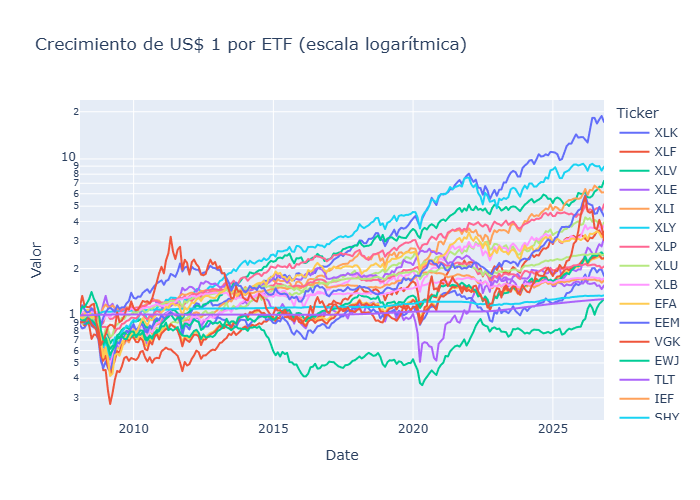
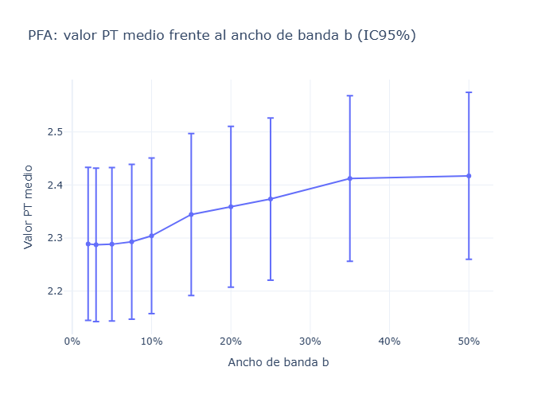
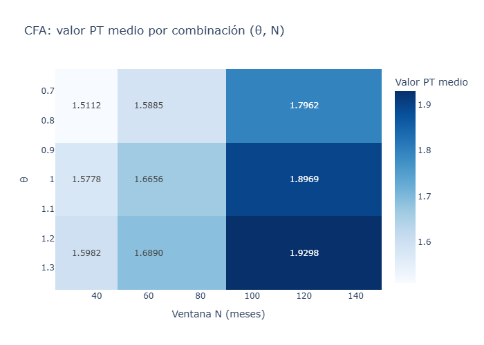
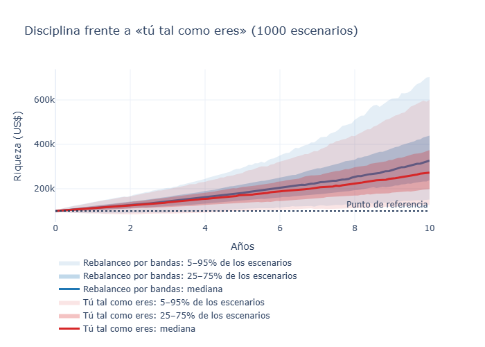
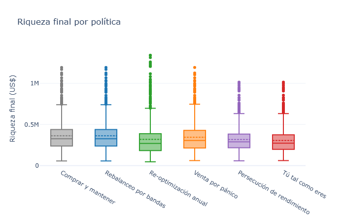

# Dashboard de portafolio conductual: informe

🌐 **Español** · [English](Report_EN.md) · [README](README.md)

Proyecto A. Problema de decisión secuencial con el marco de Powell.

**Resumen.** Una herramienta que perfila a un inversionista con prospect theory, le construye un portafolio con un MILP media-CVaR y simula 10 años mes a mes para mostrarle cuánto le cuesta su propio comportamiento. En la evaluación principal (1000 escenarios) recomendamos **comprar y mantener**: empata con el rebalanceo por bandas y es más simple. Los sesgos del cliente de referencia le quitan **US\$ 53.641** en la mediana (16%). **La recomendación cambia** si el futuro no se parece a la historia con que se armó el portafolio: en la prueba fuera de muestra, re-optimizar cada año gana en las tres fechas de corte.

El código, los datos y las instrucciones están en el README. Las tablas y los gráficos salen del notebook `portafolio_conductual.ipynb`. Dashboard: <https://dashboard-portafolio-conductual.streamlit.app>. Repositorio: <https://github.com/gemunozortiz-cell/dashboard-portafolio-conductual>.

## 1. Datos

Universo de **24 ETFs en 5 clases de activo**. Las clases hacen de "sector" para el tope de peso por sector del MILP.

| Clase | ETFs |
|---|---|
| Acciones EE.UU. (sectores) | XLK, XLF, XLV, XLE, XLI, XLY, XLP, XLU, XLB |
| Acciones internacionales | EFA, EEM, VGK, EWJ |
| Renta fija | TLT, IEF, SHY, LQD, HYG, TIP |
| Activos reales | VNQ, GLD, SLV, DBC |
| Efectivo | BIL |

Usamos precios diarios ajustados (dividendos incluidos) desde diciembre de 2007 hasta el último mes completo (octubre de 2026). El retorno de cada mes es el último precio del mes dividido por el último precio del mes anterior, menos 1. Son unos 226 meses, que incluyen la crisis de 2008, el COVID y el año 2022. BIL (letras del Tesoro de 1–3 meses) es el activo de efectivo: puede entrar en el portafolio y es el refugio del vendedor en pánico.

**Los 24 ETFs (2008-01 a 2026-10)**

|   | Nombre | Clase | Retorno anual medio | Volatilidad anual | Peor mes | Mejor mes |
|---|---|---|---|---|---|---|
| **XLK** | Tecnología EE.UU. | Acciones EE.UU. | 18.6% | 19.8% | -16.1% | 20.0% |
| **XLF** | Financiero EE.UU. | Acciones EE.UU. | 9.6% | 22.5% | -26.2% | 21.8% |
| **XLV** | Salud EE.UU. | Acciones EE.UU. | 12.2% | 14.5% | -12.4% | 12.6% |
| **XLE** | Energía EE.UU. | Acciones EE.UU. | 10.2% | 27.1% | -34.4% | 30.8% |
| **XLI** | Industrial EE.UU. | Acciones EE.UU. | 12.2% | 19.5% | -18.6% | 18.1% |
| **XLY** | Consumo discrecional EE.UU. | Acciones EE.UU. | 14.5% | 19.8% | -17.6% | 18.9% |
| **XLP** | Consumo básico EE.UU. | Acciones EE.UU. | 10.0% | 12.8% | -12.6% | 10.9% |
| **XLU** | Servicios públicos EE.UU. | Acciones EE.UU. | 8.8% | 15.1% | -13.0% | 10.6% |
| **XLB** | Materiales EE.UU. | Acciones EE.UU. | 9.6% | 20.7% | -22.4% | 17.3% |
| **EFA** | Desarrollados ex-EE.UU. | Acciones internacionales | 6.1% | 17.5% | -20.8% | 14.3% |
| **EEM** | Mercados emergentes | Acciones internacionales | 5.5% | 21.0% | -25.6% | 16.9% |
| **VGK** | Europa | Acciones internacionales | 6.6% | 19.4% | -21.8% | 16.4% |
| **EWJ** | Japón | Acciones internacionales | 6.1% | 15.6% | -15.6% | 11.6% |
| **TLT** | Bonos del Tesoro 20+ años | Renta fija | 3.4% | 14.3% | -13.1% | 14.3% |
| **IEF** | Bonos del Tesoro 7-10 años | Renta fija | 3.0% | 6.7% | -4.7% | 7.8% |
| **SHY** | Bonos del Tesoro 1-3 años | Renta fija | 1.6% | 1.5% | -1.4% | 1.7% |
| **LQD** | Bonos corporativos grado de inversión | Renta fija | 4.3% | 8.4% | -10.7% | 13.8% |
| **HYG** | Bonos de alto rendimiento | Renta fija | 5.4% | 10.2% | -11.4% | 16.8% |
| **TIP** | Bonos indexados a inflación | Renta fija | 3.1% | 5.8% | -8.1% | 6.5% |
| **VNQ** | Bienes raíces (REITs) | Activos reales | 9.3% | 22.1% | -31.7% | 30.7% |
| **GLD** | Oro | Activos reales | 9.7% | 17.7% | -16.1% | 12.8% |
| **SLV** | Plata | Activos reales | 12.0% | 33.3% | -28.5% | 33.2% |
| **DBC** | Materias primas | Activos reales | 3.2% | 19.1% | -25.1% | 16.3% |
| **BIL** | Letras del Tesoro 1-3 meses (efectivo) | Efectivo | 1.3% | 0.5% | -0.2% | 0.5% |

**Crecimiento de US\$ 1 por ETF (escala logarítmica)**



## 2. Modelo de Powell

Seguimos la notación de Powell con un solo cambio: la riqueza se llama $`W_t`$, así que la información exógena (que Powell llama $`W_{t+1}`$) aquí es $`\hat R_{t+1}`$.

### Tiempo
$`t = 0, 1, \dots, T`$ con $`T = 120`$ meses (10 años). La decisión $`x_t`$ se toma **al inicio del mes $`t`$**. Durante el mes llegan los retornos $`\hat R_{t+1}`$. En $`t=0`$ el cliente tiene todo su dinero sin invertir.

### 1. Variables de estado $`S_t`$

| Símbolo | Significado | Unidades |
|---|---|---|
| $`W_t`$ | Riqueza antes de operar | USD |
| $`w_t \in \mathbb{R}^N`$ | Pesos antes de operar, después de la deriva del mes anterior ($`w_0 = 0`$) | fracción de $`W_t`$ |
| $`P_t = \max_{s \le t} W_s`$ | Máximo de riqueza hasta la fecha (para medir caídas) | USD |
| $`H_t \in \mathbb{R}^{12 \times N}`$ | Retornos de los últimos 12 meses por activo (historia real antes de $`t=0`$, simulados después) | fracción / mes |
| $`B_t`$ | Memoria propia de cada política (ver abajo) | — |

La memoria $`B_t`$ depende de la política:
- **Venta por pánico:** el modo $`m_t \in \{\text{invertido}, \text{en efectivo}\}`$, el pico de referencia $`\hat P_t`$ (USD), un índice de mercado $`I_t`$ (el portafolio disciplinado $`w^*`$, con $`I_0 = 1`$, sin unidades) y el mínimo $`M_t`$ de ese índice desde que vendió.
- **Persecución de rendimiento:** los pesos objetivo inclinados hacia los ganadores (fracción).
- **CFA:** los pesos objetivo vigentes $`w^*_t`$ y la ventana de retornos que usa para estimar (la historia real más los meses ya simulados).

Los parámetros del cliente $`(\lambda, \alpha, \beta, W_{\text{ref}})`$ son estáticos: entran al objetivo, pero no cambian con el tiempo.

### 2. Variables de decisión $`x_t`$
$`x_{t,i}`$ es el monto operado en el activo $`i`$ (USD; compras $`>0`$, ventas $`<0`$). Es equivalente a elegir los pesos después de operar $`w_t^+`$:

```math
x_{t,i} = W_t\,(w^+_{t,i} - w_{t,i}), \qquad \sum_i w^+_{t,i} = 1, \qquad w^+_{t,i} \ge 0 .
```

No hay posiciones cortas ni apalancamiento. La decisión la toma una política $`X^\pi(S_t \mid \theta)`$.

**Qué se conoce al decidir:** todo $`S_t`$, es decir la riqueza, los pesos, el máximo y los retornos hasta el cierre del mes $`t-1`$, además de la historia real anterior a $`t=0`$. **No** se conoce $`\hat R_{t+1}`$.

### 3. Información exógena $`\hat R_{t+1}`$
$`\hat R_{t+1} \in \mathbb{R}^N`$ son los retornos simples del mes $`t+1`$ para cada activo (fracción). Los sorteamos con un **bootstrap circular por bloques** de 3 a 6 meses sobre la historia 2008–2026: cada mes sorteado es una fila histórica completa, con todos los activos de ese mes juntos, así que se conservan las correlaciones entre activos y parte de la autocorrelación (rachas, crisis).

### 4. Función de transición $`S_{t+1} = S^M(S_t, x_t, \hat R_{t+1})`$
Con un costo de transacción de $`c = 0.001`$ (10 pb) sobre el valor operado:

```math
C_t = c \sum_i |x_{t,i}| = c\, W_t \sum_i |w^+_{t,i} - w_{t,i}|
```

```math
W_{t+1} = (W_t - C_t)\,\bigl(1 + w_t^{+\top} \hat R_{t+1}\bigr)
```

```math
w_{t+1,i} = \frac{w^+_{t,i}\,(1 + \hat R_{t+1,i})}{1 + w_t^{+\top} \hat R_{t+1}}
```

```math
P_{t+1} = \max(P_t, W_{t+1}), \qquad H_{t+1} = \bigl(H_t[2{:}12],\ \hat R_{t+1}\bigr)
```

La memoria $`B_{t+1}`$ se actualiza según la regla de cada política.

### 5. Función objetivo
Buscamos la política que maximiza el valor esperado de prospect theory de la riqueza final, medido contra un punto de referencia:

```math
\max_{\pi}\ \mathbb{E}\left[ v\!\left( \frac{W^\pi_T - W_{\text{ref}}}{W_0} \right) \right], \qquad
v(x) = \begin{cases} x^\alpha & x \ge 0 \\ -\lambda\,(-x)^\beta & x < 0 \end{cases}
```

Por defecto $`W_{\text{ref}} = W_0`$ (no perder dinero). Como alternativa, $`W_{\text{ref}} = W_0 (1+g)^{10}`$ (una meta de crecimiento anual $`g`$). $`x`$ no tiene unidades: es la ganancia relativa a la riqueza inicial. Por eso el cuestionario plantea las loterías en % del portafolio, y así $`\alpha`$, $`\beta`$ y $`\lambda`$ quedan en las mismas unidades que $`x`$. No hay recompensas intermedias: los costos entran a través de la transición. Además reportamos la media y los percentiles de $`W_T`$, la caída máxima y los costos pagados.

### Políticas

| Política | Clase | Regla | Parámetros ajustables |
|---|---|---|---|
| Comprar y mantener | Baseline | Compra el portafolio de la Parte 2 en $`t=0`$ y no vuelve a operar | — |
| Rebalanceo por bandas | **PFA** | Si $`\max_i \lvert w_{t,i} - w^*_i\rvert > b`$, vuelve a $`w^*`$; si no, no opera | $`b`$ |
| Re-optimización anual | **CFA** | Cada 12 meses resuelve el MILP con límite $`c(\lambda)\,\theta`$ sobre los últimos $`N`$ meses y lleva el portafolio a la solución | $`\theta`$, $`N`$ |
| Venta por pánico | Conductual | Encima de la PFA: si la caída llega a $`d`$, vende una fracción $`\varphi`$ a efectivo; vuelve cuando el mercado rebota $`r`$: $`I_t \ge M_t(1+r)`$ | $`d, r, \varphi`$ (del cuestionario) |
| Persecución de rendimiento | Conductual | Encima de la PFA: cada $`f`$ meses, objetivo $`= (1-\kappa)\,w^* + \kappa \cdot`$ (3 mejores activos a 12 meses) | $`\kappa, f`$ (del cuestionario) |
| Tú tal como eres | Conductual | La PFA con los sesgos que detectó el cuestionario | — |

### Justificación de los métodos
- **MILP media-CVaR en vez de un MIQP media-varianza.** Es lineal, así que se resuelve en milisegundos, y eso importa porque la CFA lo vuelve a resolver miles de veces dentro del simulador. El CVaR mide la cola de pérdidas, que es justo lo que le duele a un cliente con aversión a pérdidas. Y el límite $`c(\lambda)`$ se explica fácil: "a mayor aversión a pérdidas, menor pérdida tolerada en un mal mes".
- **Bootstrap por bloques.** No supone normalidad; conserva las colas gruesas, las correlaciones entre activos y la dependencia de corto plazo (de 3 a 6 meses).
- **PFA de bandas.** Es la regla más usada en la práctica, tiene un solo parámetro y es fácil de seguir para el cliente.
- **CFA de re-optimización.** Usa el modelo de la Parte 2 como aproximación determinista que se reajusta con la información nueva. El factor $`\theta`$ y la ventana $`N`$ corrigen que el MILP ignora el futuro.
- **Por qué no VFA ni DLA.** El estado es continuo y de alta dimensión (24 pesos más la historia reciente). Aproximar una función de valor sobre ese estado (VFA), o resolver una anticipación estocástica en cada mes de cada escenario (DLA), no es viable en una semana ni es fácil de explicar al cliente.

## 3. Parte 1: cuestionario y perfil del cliente

Son 11 preguntas, todas expresadas en % del portafolio:

- **λ (3 preguntas).** Lotería 50/50: "pierdes L% o ganas G%", con L = 5%, 10% y 20%. El cliente elige la **menor G con la que aceptaría**. Tomamos $`\lambda = \text{mediana}(G/L)`$, acotada a $`[1, 5]`$; la respuesta "no aceptaría" cuenta como 5. Aparte reportamos el λ corregido por curvatura, $`G^\alpha / L^\beta`$.
- **α (2 preguntas).** Equivalente cierto (CE) de "50%: ganas G; 50%: nada", con G = 10% y 30%. Si $`CE^\alpha = \tfrac12 G^\alpha`$, entonces $`\alpha = \ln(0.5)/\ln(CE/G)`$. Promediamos las dos y acotamos a $`[0.2, 1]`$.
- **β (2 preguntas).** La mayor pérdida segura que el cliente aceptaría para evitar "50%: pierdes L; 50%: nada". Por el mismo razonamiento, $`\beta = \ln(0.5)/\ln(CE/L)`$.
- **Sesgos (4 preguntas).** Cada respuesta fija los parámetros de las políticas conductuales:

| Pregunta | Respuesta → parámetro |
|---|---|
| B1: "Tu portafolio cayó 20% en tres meses" | Vendo todo → pánico con $`d=10\%`$, $`\varphi=1`$ · Vendo una parte → pánico con $`d=20\%`$, $`\varphi=0.5`$ · No hago nada / compro más → sin pánico |
| B2: "¿Cuándo volverías a invertir?" | Rebote de 5% → $`r=5\%`$ · de 15% → $`r=15\%`$ · cuando recupere todo → $`r=25\%`$ |
| B3: "Un ETF subió 40% y tu portafolio 5%" | Muevo buena parte → $`\kappa=0.5`$ · Un poco → $`\kappa=0.25`$ · Nada → sin persecución |
| B4: "¿Cada cuánto revisas tu portafolio?" | Mensual → $`f=1`$ · Trimestral → $`f=3`$ · Anual → $`f=12`$ |

No usamos ponderación de probabilidades: el enunciado solo pide la función de valor $`v(x)`$.

### Cliente de referencia

Para ajustar las políticas y para la evaluación del informe usamos un **cliente de referencia** con los parámetros clásicos de Tversky y Kahneman (λ = 2.25, α = β = 0.88). Le asignamos además los dos sesgos con sus parámetros típicos (pánico con d = 20%, r = 15%, φ = 1; persecución con κ = 0.25 cada 3 meses), para que la evaluación muestre el costo de ambos. En el dashboard, cada cliente obtiene sus propios parámetros.

## 4. Parte 2: portafolio MILP media-CVaR (Gurobi)

**Variables.** $`w_i \ge 0`$ es el peso del activo $`i`$; $`z_i \in \{0,1\}`$ indica si el activo entra; $`\zeta`$ es el VaR; $`u_s \ge 0`$ es el exceso de pérdida en el mes histórico $`s`$.

```math
\max_{w,z,\zeta,u}\ \bar r^\top w
```

sujeto a:

```math
\sum_i w_i = 1,\qquad \sum_i z_i \le K,\qquad l\,z_i \le w_i \le u\,z_i,\qquad \sum_{i \in c} w_i \le \bar w_c\ \ \forall c
```

```math
u_s \ge -r_s^\top w - \zeta,\qquad \zeta + \frac{1}{(1-\beta_{\text{CVaR}})\,S} \sum_s u_s \le c(\lambda)
```

La última restricción es la linealización de Rockafellar–Uryasev del CVaR al 95%, calculada sobre los $`S`$ meses históricos.

**Vínculo con el perfil.** El límite de pérdida en meses malos baja en línea recta con la aversión a pérdidas:

```math
c(\lambda) = \theta\,\Bigl[c_{\max} - (c_{\max} - c_{\min})\,\tfrac{\lambda - 1}{4}\Bigr], \qquad c_{\max} = 10\%,\ c_{\min} = 2\%\ (\text{CVaR mensual}),\ \lambda \in [1,5].
```

En la Parte 2, $`\theta = 1`$; la CFA ajusta $`\theta`$. Valores por defecto: $`K = 8`$, $`l = 5\%`$, $`u = 35\%`$ y tope por clase de $`50\%`$, todos modificables en el dashboard. Si el límite de CVaR resulta infactible, el modelo usa el portafolio de mínimo CVaR y lo informa.

**Portafolio del cliente de referencia: retorno 13.42% anual, CVaR mensual 7.50%**

|   | Nombre | Clase | Peso | Monto a invertir (US\$) |
|---|---|---|---|---|
| **XLK** | Tecnología EE.UU. | Acciones EE.UU. | 35.0% | 35,000 |
| **GLD** | Oro | Activos reales | 35.0% | 35,000 |
| **XLV** | Salud EE.UU. | Acciones EE.UU. | 10.0% | 10,000 |
| **SLV** | Plata | Activos reales | 8.7% | 8,683 |
| **VNQ** | Bienes raíces (REITs) | Activos reales | 6.3% | 6,317 |
| **XLY** | Consumo discrecional EE.UU. | Acciones EE.UU. | 5.0% | 5,000 |

**Cómo cambia el portafolio con λ**

| λ | Límite CVaR | CVaR | Retorno anual | Activos | Estado |
|---|---|---|---|---|---|
| **1** | 10.0% | 10.00% | 14.21% | 4 | óptimo |
| **2.25** | 7.5% | 7.50% | 13.42% | 6 | óptimo |
| **4** | 4.0% | 4.00% | 9.00% | 6 | óptimo |
| **5** | 2.0% | 2.00% | 5.16% | 5 | óptimo |

## 5. Escenarios: bootstrap circular por bloques

Cada escenario son 120 meses armados con bloques de meses históricos consecutivos. La longitud de cada bloque se sortea uniformemente entre 3 y 6 meses, y el bloque empieza en un mes al azar (circular: si pasa del último mes, sigue por el primero). Cada mes sorteado es **una fila histórica completa**, con los 24 activos de ese mes.

**Números aleatorios comunes.** Por cada semilla generamos un solo tensor (escenarios × meses × activos), y **todas** las políticas se simulan sobre ese mismo tensor. Así, la diferencia entre dos políticas mide el efecto de la política y no la suerte de cada una.

| Uso | Semilla | Escenarios |
|---|---|---|
| Ajuste de parámetros | 2026 | 300 (150 para la CFA) |
| Evaluación final | 7777 | 1000 |
| Pruebas unitarias | 123 | 50 |

## 6. Parte 3: simulador y políticas

Todas las políticas cumplen la misma interfaz: `decide(estado) → pesos después de operar` (una fila por escenario). El simulador está vectorizado: avanza los 1000 escenarios a la vez, mes a mes, aplicando la función de transición de la sección 2. Además valida en cada mes que los pesos sumen 1 y no sean negativos.

**Detalles de las políticas conductuales.**
- **Venta por pánico.** Mide la caída contra su propio pico de referencia. Al llegar a $`d`$, vende la fracción $`\varphi`$ de cada posición y la pasa a BIL. Mientras está fuera, no opera, y sigue el mínimo $`M_t`$ de un índice de mercado $`I_t`$ (el portafolio disciplinado $`w^*`$). Cuando $`I_t \ge M_t(1+r)`$, vuelve a los pesos objetivo y reinicia su pico de referencia. Sin ese reinicio volvería a vender al mes siguiente, porque la riqueza sigue lejos del máximo anterior. El rebote se mide en el mercado y no en la riqueza del cliente: en efectivo su riqueza casi no se mueve y nunca volvería a invertir.
- **Persecución de rendimiento.** Cada $`f`$ meses calcula el retorno acumulado de 12 meses de cada activo y lleva su objetivo a $`(1-\kappa)\,w^* + \kappa \cdot`$ (pesos iguales en los 3 mejores). Opera hasta ese objetivo y, entre revisiones, rebalancea por bandas alrededor de él.

**Políticas, clase y parámetros (valores de ejemplo)**

| Política | Clase | Parámetros |
|---|---|---|
| **Comprar y mantener** | Baseline | {} |
| **Rebalanceo por bandas** | PFA | {'b': 0.05} |
| **Re-optimización anual** | CFA | {'theta': 1.0, 'window': 60} |
| **Venta por pánico** | Conductual | {'d': 0.2, 'r': 0.15, 'phi': 1.0} |
| **Persecución de rendimiento** | Conductual | {'kappa': 0.25, 'f': 3, 'top_k': 3} |
| **Tú tal como eres** | Conductual (perfil) | {'d': 0.2, 'r': 0.15, 'phi': 1.0} |

## 7. Ajuste de parámetros (solo escenarios de ajuste, semilla 2026)

Buscamos en una cuadrícula el valor de los parámetros que maximiza el **valor PT medio** del cliente de referencia. El ajuste usa **solo** los escenarios de la semilla de ajuste; la evaluación final (sección 8) usa otra semilla, así que los resultados finales no premian el sobreajuste.

- **PFA:** $`b \in \{2, 3, 5, 7.5, 10, 15, 20, 25, 35, 50\}\%`$ (con 50% casi nunca rebalancea: es comprar y mantener) sobre 300 escenarios.
- **CFA:** $`\theta \in \{0.75, 1, 1.25\}`$ × $`N \in \{36, 60, 120\}`$ meses sobre 150 escenarios. Son 9 combinaciones × 150 escenarios × 9 re-optimizaciones, unas 12.000 resoluciones del MILP.

Las políticas conductuales no se ajustan: sus parámetros son una descripción del cliente, no una decisión que se optimice.

**Ajuste de la PFA: b\* = 50%**

| b | Valor PT medio | Error estándar | Riqueza mediana | Costos medios |
|---|---|---|---|---|
| **50.0%** | 2.4172 | 0.0803 | 343,431 | 100 |
| **35.0%** | 2.4122 | 0.0797 | 344,061 | 122 |
| **25.0%** | 2.3735 | 0.0780 | 335,373 | 154 |
| **20.0%** | 2.3589 | 0.0773 | 330,452 | 168 |
| **15.0%** | 2.3444 | 0.0779 | 325,255 | 198 |
| **10.0%** | 2.3042 | 0.0748 | 327,974 | 235 |
| **7.5%** | 2.2929 | 0.0744 | 322,446 | 270 |
| **2.0%** | 2.2890 | 0.0735 | 326,000 | 587 |
| **5.0%** | 2.2883 | 0.0738 | 329,712 | 337 |
| **3.0%** | 2.2872 | 0.0738 | 327,775 | 451 |

**PFA: valor PT medio frente al ancho de banda**



**Ajuste de la CFA: θ\* = 1.25, N\* = 120**

| θ | N (meses) | Valor PT medio | Error estándar | Riqueza mediana | Costos medios |
|---|---|---|---|---|---|
| **1.25** | 120 | 1.9298 | 0.1298 | 276,668 | 871 |
| **1** | 120 | 1.8969 | 0.1096 | 273,841 | 874 |
| **0.75** | 120 | 1.7962 | 0.0862 | 269,753 | 780 |
| **1.25** | 60 | 1.6890 | 0.1241 | 250,222 | 1,177 |
| **1** | 60 | 1.6656 | 0.1108 | 251,419 | 1,228 |
| **1.25** | 36 | 1.5982 | 0.1211 | 238,074 | 1,507 |
| **0.75** | 60 | 1.5885 | 0.0942 | 250,358 | 1,288 |
| **1** | 36 | 1.5778 | 0.1184 | 233,302 | 1,532 |
| **0.75** | 36 | 1.5112 | 0.1048 | 222,135 | 1,580 |

**CFA: valor PT medio por (θ, N)**



**Cómo leer el ajuste.** Si $`b^*`$ queda en el extremo superior de la cuadrícula, rebalancear no agrega valor para este cliente con los datos 2008–2026: con una banda tan ancha la PFA casi nunca opera y converge al baseline de comprar y mantener. Al no rebalancear crece el peso del activo de mayor retorno (tecnología, XLK), y eso sube la riqueza esperada; a cambio sube el riesgo, que la función objetivo casi no castiga, porque a 10 años muy pocos futuros terminan en pérdida (ver el diagnóstico de la sección 9). Si $`\theta^*`$ o $`N^*`$ quedan en el borde de su cuadrícula, el verdadero óptimo puede estar más allá: no exploramos $`\theta > 1.25`$ (más riesgo del que el cliente tolera) ni $`N > 120`$. La sección 9 muestra si la conclusión cambia con otras condiciones.

## 8. Evaluación final (1000 escenarios, semilla 7777)

Las seis políticas se simulan sobre **el mismo** tensor de 1000 escenarios, que no se usó para ajustar. Para cada una reportamos:
- **la métrica principal**, el valor PT de la riqueza final: media, desviación estándar, P5/P95 e IC95% de la media (normal y bootstrap);
- **el equivalente cierto**: la riqueza segura que el cliente valora igual que la política, $`W_{\text{ref}} + W_0 \cdot v^{-1}(\text{valor PT medio})`$;
- **la riqueza final**: media, percentiles e IC;
- **diferencias pareadas** frente a la PFA, escenario por escenario. Aprovechan los números aleatorios comunes: la variabilidad del mercado se cancela y queda solo el efecto de la política.

**Resultados: 1000 escenarios, US\$ 100.000 iniciales**

| Política | Comprar y mantener | Rebalanceo por bandas | Re-optimización anual | Venta por pánico | Persecución de rendimiento | Tú tal como eres |
|---|---|---|---|---|---|---|
| **Clase** | Baseline | PFA | CFA | Conductual | Conductual | Conductual (perfil) |
| **Valor PT medio** | 2.2864 | 2.2867 | 1.9088 | 2.1264 | 1.9379 | 1.8297 |
| **Valor PT desv.** | 1.3647 | 1.3650 | 1.5492 | 1.4004 | 1.1644 | 1.2065 |
| **Valor PT P5** | 0.5564 | 0.5564 | 0.1623 | 0.3804 | 0.4612 | 0.3162 |
| **Valor PT P95** | 4.8618 | 4.8618 | 4.8468 | 4.8347 | 4.1359 | 4.1212 |
| **IC95% PT (normal)** | [2.2018, 2.3709] | [2.2021, 2.3713] | [1.8128, 2.0048] | [2.0396, 2.2132] | [1.8658, 2.0101] | [1.7549, 1.9045] |
| **IC95% PT (bootstrap)** | [2.2066, 2.3696] | [2.2066, 2.3698] | [1.8188, 2.0050] | [2.0420, 2.2124] | [1.8702, 2.0081] | [1.7583, 1.9016] |
| **Equivalente cierto (US\$)** | 355,928 | 355,966 | 308,474 | 335,678 | 312,090 | 298,683 |
| **Riqueza final media** | 362,799 | 362,839 | 318,913 | 343,671 | 317,977 | 305,619 |
| **Riqueza desv.** | 177,481 | 177,515 | 199,506 | 179,853 | 147,806 | 151,473 |
| **Riqueza P5** | 151,370 | 151,370 | 112,667 | 133,340 | 141,501 | 127,025 |
| **Riqueza P50** | 326,297 | 326,297 | 269,775 | 304,734 | 289,581 | 272,656 |
| **Riqueza P95** | 703,185 | 703,185 | 701,073 | 699,368 | 601,939 | 599,908 |
| **IC95% riqueza media** | [351,799, 373,799] | [351,837, 373,841] | [306,548, 331,278] | [332,524, 354,818] | [308,816, 327,138] | [296,230, 315,007] |
| **Caída máx. mediana** | 20.8% | 20.8% | 29.6% | 20.9% | 19.8% | 19.8% |
| **Costos medios** | 100 | 101 | 880 | 480 | 1,908 | 2,103 |
| **Rotación anual media** | 5.4% | 5.4% | 48.3% | 29.4% | 102.7% | 118.4% |

**Diferencias pareadas frente a la PFA**

| Política | Δ valor PT medio | IC95% Δ PT | ¿Diferencia significativa? | Δ riqueza media (US\$) | IC95% Δ riqueza | Δ riqueza mediana (US\$) | Prob. de superar a «Rebalanceo por bandas» |
|---|---|---|---|---|---|---|---|
| **Comprar y mantener** | -0.0003 | [-0.0009, 0.0003] | no | -40 | [-119, 39] | 0 | 0% |
| **Re-optimización anual** | -0.3778 | [-0.4219, -0.3337] | sí | -43,926 | [-49,702, -38,149] | -56,522 | 23% |
| **Venta por pánico** | -0.1603 | [-0.1776, -0.1430] | sí | -19,168 | [-21,341, -16,995] | -21,563 | 7% |
| **Persecución de rendimiento** | -0.3487 | [-0.3767, -0.3208] | sí | -44,862 | [-48,635, -41,088] | -36,716 | 18% |
| **Tú tal como eres** | -0.4569 | [-0.4868, -0.4271] | sí | -57,220 | [-61,201, -53,240] | -53,641 | 14% |

**Costo de las conductas frente a la disciplina**

| Conducta | Costo en la mediana (US\$) | Costo medio (US\$) | IC95% costo medio | Escenarios peores que la disciplina |
|---|---|---|---|---|
| **Venta por pánico** | 21,563 | 19,168 | [16,995, 21,341] | 46% |
| **Persecución de rendimiento** | 36,716 | 44,862 | [41,088, 48,635] | 82% |
| **Tú tal como eres** | 53,641 | 57,220 | [53,240, 61,201] | 86% |

**Riqueza simulada: disciplina (azul) y tal como es el cliente (rojo)**



**Riqueza final por política**



## 9. Sensibilidad y recomendación

¿Bajo qué condiciones cambia la recomendación? Repetimos la comparación entre las tres políticas que optimizan, sobre los primeros 300 escenarios de evaluación, cambiando una cosa a la vez:
- **la aversión a pérdidas λ**, que cambia el portafolio de la Parte 2, la CFA y la métrica;
- **los costos de transacción**: 50 pb en vez de 10 pb;
- **el punto de referencia**: una meta de 4% anual en vez de "no perder".

Los parámetros ajustados ($`b^*`$, $`\theta^*`$, $`N^*`$) se mantienen fijos; solo cambian las condiciones.

Después hay dos análisis más:
- **Diagnóstico:** cuánto pesa λ en el objetivo y cómo cambian los pesos y el riesgo de comprar y mantener después de 10 años.
- **Prueba fuera de muestra:** la evaluación principal arma el portafolio con la misma historia de la que sortea los futuros, y eso favorece a comprar y mantener. Aquí el portafolio se arma solo con los datos **anteriores** a una fecha y los futuros se sortean solo de los **posteriores**, con tres fechas de corte.

**Sensibilidad (300 escenarios)**

| Escenario | PT medio · Comprar y mantener | PT medio · Rebalanceo por bandas | PT medio · Re-optimización anual | Mayor PT | Recomendada |
|---|---|---|---|---|---|
| **Base (λ = 2.25, 10 pb, referencia = W0)** | 2.2402 | 2.2402 | 1.8868 | Comprar y mantener | Comprar y mantener |
| **Aversión baja (λ = 1)** | 2.3450 | 2.3450 | 1.8821 | Comprar y mantener | Comprar y mantener |
| **Aversión alta (λ = 4)** | 1.6634 | 1.6598 | 1.5958 | Comprar y mantener | Comprar y mantener |
| **Costos de 50 pb** | 2.2290 | 2.2290 | 1.8348 | Comprar y mantener | Comprar y mantener |
| **Meta de 4% anual** | 1.8307 | 1.8307 | 1.4117 | Comprar y mantener | Comprar y mantener |

**Deriva de los pesos de comprar y mantener. Solo el 0.4% de los futuros termina bajo la riqueza inicial; el CVaR final supera el límite del cliente en el 79%**

|   | Peso inicial | Peso final mediano | Peso final P95 |
|---|---|---|---|
| **XLK** | 35.0% | 49.8% | 70.0% |
| **XLV** | 10.0% | 8.8% | 16.8% |
| **XLY** | 5.0% | 4.9% | 8.3% |
| **VNQ** | 6.3% | 3.8% | 8.3% |
| **GLD** | 35.0% | 23.9% | 48.2% |
| **SLV** | 8.7% | 4.6% | 16.8% |

**Prueba fuera de muestra (300 escenarios por corte)**

| Corte | Política | Valor PT medio | Riqueza P5 | Riqueza P50 | Caída máx. mediana | Δ PT vs. comprar y mantener | IC95% bajo | IC95% alto |
|---|---|---|---|---|---|---|---|---|
| **2014-12** | Comprar y mantener | 1.320 | 125,634 | 221,312 | 18.7% | +0.000 | +0.000 | +0.000 |
| **2014-12** | Rebalanceo por bandas (b = 5%) | 1.086 | 119,987 | 198,404 | 18.4% | -0.234 | -0.270 | -0.198 |
| **2014-12** | Re-optimización anual (θ\*, N\*) | 1.947 | 158,257 | 285,061 | 20.8% | +0.626 | +0.546 | +0.707 |
| **2014-12** | Re-optimización anual (θ = 1, N = 60, sin ajustar) | 1.980 | 145,440 | 294,196 | 21.0% | +0.660 | +0.578 | +0.742 |
| **2017-12** | Comprar y mantener | 2.114 | 132,756 | 290,625 | 23.9% | +0.000 | +0.000 | +0.000 |
| **2017-12** | Rebalanceo por bandas (b = 5%) | 1.392 | 115,737 | 226,562 | 23.1% | -0.721 | -0.802 | -0.640 |
| **2017-12** | Re-optimización anual (θ\*, N\*) | 2.669 | 183,918 | 340,271 | 24.5% | +0.555 | +0.450 | +0.661 |
| **2017-12** | Re-optimización anual (θ = 1, N = 60, sin ajustar) | 3.018 | 190,556 | 384,065 | 23.2% | +0.904 | +0.767 | +1.041 |
| **2019-12** | Comprar y mantener | 1.984 | 116,933 | 272,143 | 26.0% | +0.000 | +0.000 | +0.000 |
| **2019-12** | Rebalanceo por bandas (b = 5%) | 1.214 | 94,339 | 210,640 | 25.8% | -0.769 | -0.864 | -0.675 |
| **2019-12** | Re-optimización anual (θ\*, N\*) | 3.271 | 193,406 | 415,158 | 26.3% | +1.287 | +1.105 | +1.469 |
| **2019-12** | Re-optimización anual (θ = 1, N = 60, sin ajustar) | 3.639 | 199,853 | 445,248 | 24.9% | +1.655 | +1.422 | +1.888 |

### Recomendación

**Recomendamos «Comprar y mantener»** para el cliente de referencia: no es significativamente peor que «Rebalanceo por bandas» (el IC95% de la diferencia de valor PT, [-0.0009, 0.0003], incluye 0) y es más simple de seguir.

- Valor PT medio por política (1000 escenarios de evaluación): Comprar y mantener: 2.2864; Rebalanceo por bandas: 2.2867; Re-optimización anual: 1.9088.
- Equivalente cierto de la política recomendada (la riqueza segura que el cliente valora igual): US\$ 355.928.
- IC95% del valor PT de la política recomendada: [2.2018, 2.3709].
- Mediana de la riqueza final con la política recomendada: US\$ 326.297; percentiles 5–95: US\$ 151.370 a US\$ 703.185.
- **El comportamiento cuesta caro:** los sesgos del cliente de referencia (pánico + persecución) le quitan US\$ 53.641 en la mediana frente a la disciplina. Es un costo del mismo orden que el de elegir la re-optimización anual en vez de comprar y mantener en esta evaluación (US\$ 56.522).

**Cuándo cambiaría esta recomendación** (análisis de sensibilidad, 300 escenarios):
- En ninguna de las variantes de sensibilidad (λ, costos, meta) cambia la política recomendada.
- **Si el futuro no se parece a la historia con que se armó el portafolio, sí cambia.** En la prueba fuera de muestra, la re-optimización anual (θ*, N*) supera significativamente a comprar y mantener en 3 de 3 fechas de corte.
- Comprar y mantener deja subir el riesgo: al cabo de 10 años el CVaR supera el límite del cliente en 79% de los futuros. Conviene una revisión anual.
- Si el cliente no puede seguir la regla durante las caídas, la prioridad es la disciplina (acompañamiento, reglas automáticas) antes que elegir entre PFA y CFA.
- Si cambia el universo o el régimen de mercado (por ejemplo, tasas mucho más altas o más bajas que en 2008–2026), hay que volver a ajustar los parámetros con datos nuevos.

**Limitaciones.**
- El bootstrap y el MILP de la Parte 2 usan la misma historia, así que el portafolio "conoce" la distribución de la que se sortean los escenarios. Eso favorece a comprar y mantener en la evaluación principal; por eso agregamos la prueba fuera de muestra.
- La prueba fuera de muestra usa 300 escenarios por corte y sortea los futuros de un periodo corto (82 a 142 meses): dentro de él el mercado es estable y la CFA alcanza a aprenderlo, lo que la favorece. Además, $`\theta^*`$ y $`N^*`$ se ajustaron con toda la historia; por eso incluimos una CFA sin ajustar.
- $`\theta^*`$ y $`N^*`$ quedaron en el borde de su cuadrícula.
- El cuestionario no está validado con personas reales.
- No modelamos impuestos, aportes, retiros ni inflación.
- La ponderación de probabilidades de prospect theory acumulativa queda fuera por diseño.

## 10. Dashboard de Streamlit

La app usa el mismo paquete `core`. Carga los retornos y los parámetros ajustados que guardó este notebook (`data/`), así que no depende de yfinance durante la reunión con el cliente. Es **bilingüe**: un selector en la barra lateral (o `?lang=en` en la URL) cambia entre español e inglés. Tiene cuatro pestañas:

1. **Cuestionario:** las 11 preguntas y el perfil estimado, explicado en frases.
2. **Mi portafolio:** la decisión recomendada de hoy (qué comprar y cuánto), su composición por clase y la pérdida típica en meses malos.
3. **Mi futuro:** gráfico de abanico de 500 futuros simulados, con disciplina y "tú tal como eres".
4. **Comparar reglas:** la recomendación, el costo en dinero de cada sesgo y la comparación de políticas en lenguaje simple.

En la barra lateral el cliente cambia su riqueza inicial y su meta, y el asesor ajusta K, l, u, el tope por clase, λ, α, β y los sesgos. El MILP y la simulación corren en vivo y quedan en caché; la CFA, que es más lenta, se calcula al pulsar un botón.
