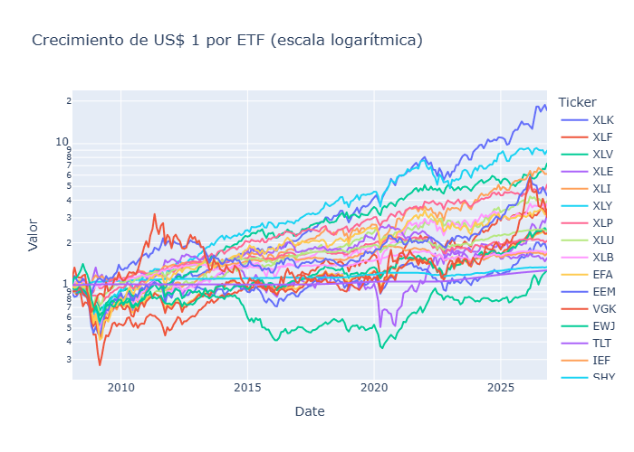
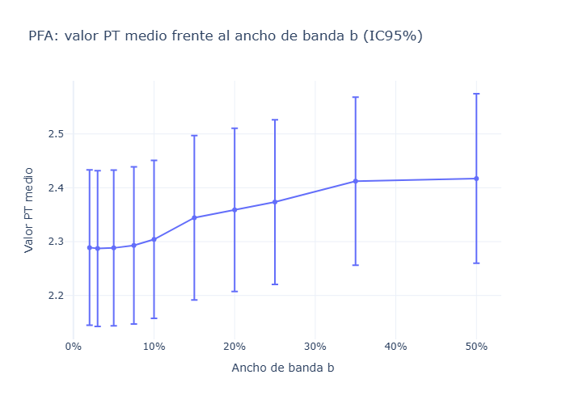
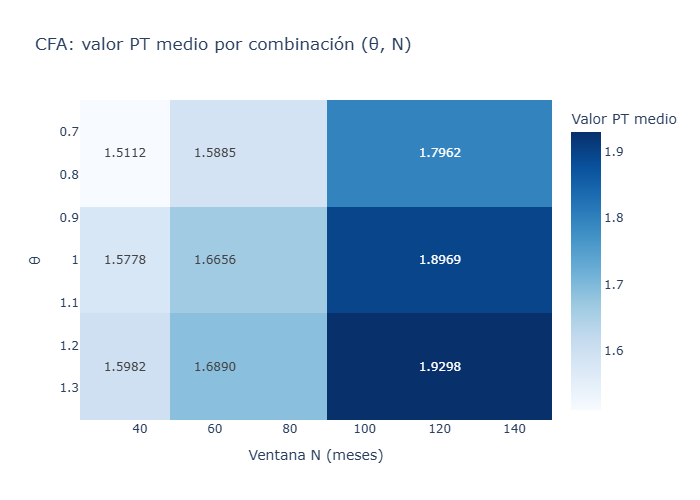
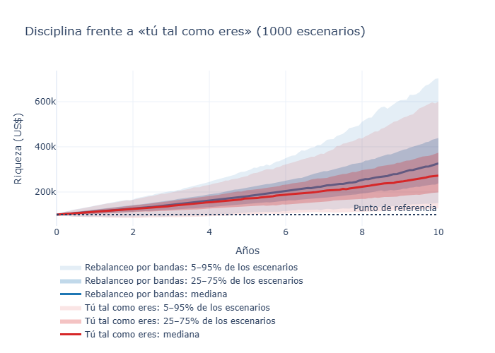
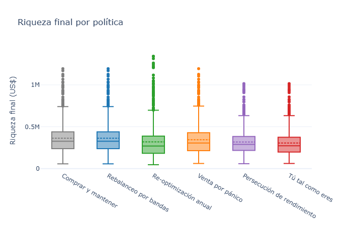

# Behavioral portfolio dashboard: report

🌐 **English** · [Español](Informe_ES.md) · [README](README.en.md)

Project A. Sequential decision problem with Powell's framework.

**Summary.** A tool that profiles an investor with prospect theory, builds their portfolio with a mean-CVaR MILP and simulates 10 years month by month to show what their own behavior costs. In the main evaluation (1,000 scenarios) we recommend **buy and hold**: it ties with band rebalancing and is simpler. The reference client's biases cost **US\$ 53,641** at the median (16%). **The recommendation changes** if the future does not look like the history used to build the portfolio: in the out-of-sample test, re-optimizing every year wins at all three cut dates.

The code, data and instructions are in the README. Tables and charts come from the notebook `portafolio_conductual.ipynb`. Dashboard: <https://dashboard-portafolio-conductual.streamlit.app/?lang=en>. Repository: <https://github.com/gemunozortiz-cell/dashboard-portafolio-conductual>.

## 1. Data

Universe of **24 ETFs in 5 asset classes**. The classes act as the "sector" for the MILP's per-sector weight cap.

| Class | ETFs |
|---|---|
| US equities (sectors) | XLK, XLF, XLV, XLE, XLI, XLY, XLP, XLU, XLB |
| International equities | EFA, EEM, VGK, EWJ |
| Fixed income | TLT, IEF, SHY, LQD, HYG, TIP |
| Real assets | VNQ, GLD, SLV, DBC |
| Cash | BIL |

We use adjusted daily prices (dividends included) from December 2007 to the last complete month (October 2026). Each month's return is the last price of the month divided by the last price of the previous month, minus 1. That is about 226 months, including the 2008 crisis, COVID and 2022. BIL (1–3 month Treasury bills) is the cash asset: it can enter the portfolio and it is where the panic seller takes refuge.

**The 24 ETFs (2008-01 to 2026-10)**

|   | Name | Class | Mean annual return | Annual volatility | Worst month | Best month |
|---|---|---|---|---|---|---|
| **XLK** | US technology | US equities | 18.6% | 19.8% | -16.1% | 20.0% |
| **XLF** | US financials | US equities | 9.6% | 22.5% | -26.2% | 21.8% |
| **XLV** | US health care | US equities | 12.2% | 14.5% | -12.4% | 12.6% |
| **XLE** | US energy | US equities | 10.2% | 27.1% | -34.4% | 30.8% |
| **XLI** | US industrials | US equities | 12.2% | 19.5% | -18.6% | 18.1% |
| **XLY** | US consumer discretionary | US equities | 14.5% | 19.8% | -17.6% | 18.9% |
| **XLP** | US consumer staples | US equities | 10.0% | 12.8% | -12.6% | 10.9% |
| **XLU** | US utilities | US equities | 8.8% | 15.1% | -13.0% | 10.6% |
| **XLB** | US materials | US equities | 9.6% | 20.7% | -22.4% | 17.3% |
| **EFA** | Developed markets ex-US | International equities | 6.1% | 17.5% | -20.8% | 14.3% |
| **EEM** | Emerging markets | International equities | 5.5% | 21.0% | -25.6% | 16.9% |
| **VGK** | Europe | International equities | 6.6% | 19.4% | -21.8% | 16.4% |
| **EWJ** | Japan | International equities | 6.1% | 15.6% | -15.6% | 11.6% |
| **TLT** | US Treasuries 20+ years | Fixed income | 3.4% | 14.3% | -13.1% | 14.3% |
| **IEF** | US Treasuries 7-10 years | Fixed income | 3.0% | 6.7% | -4.7% | 7.8% |
| **SHY** | US Treasuries 1-3 years | Fixed income | 1.6% | 1.5% | -1.4% | 1.7% |
| **LQD** | Investment-grade corporate bonds | Fixed income | 4.3% | 8.4% | -10.7% | 13.8% |
| **HYG** | High-yield bonds | Fixed income | 5.4% | 10.2% | -11.4% | 16.8% |
| **TIP** | Inflation-linked bonds | Fixed income | 3.1% | 5.8% | -8.1% | 6.5% |
| **VNQ** | Real estate (REITs) | Real assets | 9.3% | 22.1% | -31.7% | 30.7% |
| **GLD** | Gold | Real assets | 9.7% | 17.7% | -16.1% | 12.8% |
| **SLV** | Silver | Real assets | 12.0% | 33.3% | -28.5% | 33.2% |
| **DBC** | Commodities | Real assets | 3.2% | 19.1% | -25.1% | 16.3% |
| **BIL** | Treasury bills 1-3 months (cash) | Cash | 1.3% | 0.5% | -0.2% | 0.5% |

**Growth of US\$ 1 per ETF (log scale; labels in Spanish)**



## 2. Powell model

We follow Powell's notation with one change: wealth is called $`W_t`$, so the exogenous information (which Powell calls $`W_{t+1}`$) is $`\hat R_{t+1}`$ here. 

**Time.** $`t = 0, 1, \dots, T`$ with $`T = 120`$ months (10 years). The decision $`x_t`$ is made **at the start of month $`t`$**; the returns $`\hat R_{t+1}`$ arrive during the month. At $`t=0`$ the client holds all their money uninvested.

**1. State variables $`S_t`$**

| Symbol | Meaning | Units |
|---|---|---|
| $`W_t`$ | Wealth before trading | USD |
| $`w_t`$ | Weights before trading, after last month's drift ($`w_0 = 0`$) | fraction of $`W_t`$ |
| $`P_t`$ | Highest wealth so far (to measure drawdowns) | USD |
| $`H_t`$ | Last 12 monthly returns per asset (real history before $`t=0`$, simulated after) | fraction / month |
| $`B_t`$ | Each policy's own memory | — |

The memory $`B_t`$ depends on the policy: **panic selling** keeps its mode (invested / in cash), its reference peak (USD), a market index $`I_t`$ (the disciplined portfolio $`w^*`$, $`I_0 = 1`$, no units) and the minimum $`M_t`$ of that index since it sold; **performance chasing** keeps the target weights tilted toward the winners; the **CFA** keeps its current target weights and the return window it estimates from. The client's parameters $`(\lambda, \alpha, \beta, W_{\text{ref}})`$ are static: they enter the objective but do not change over time.

**2. Decision variables $`x_t`$.** $`x_{t,i}`$ is the amount traded in asset $`i`$ (USD; buys $`>0`$, sells $`<0`$). It is equivalent to choosing the post-trade weights $`w_t^+`$, which add up to 1 and are non-negative: no short positions and no leverage. The decision is made by a policy $`X^\pi(S_t \mid \theta)`$.

```math
x_{t,i} = W_t\,(w^+_{t,i} - w_{t,i}), \qquad \sum_i w^+_{t,i} = 1, \qquad w^+_{t,i} \ge 0 .
```

**What is known when deciding:** all of $`S_t`$, that is, wealth, weights, the peak and the returns up to the close of month $`t-1`$, plus the real history before $`t=0`$. $`\hat R_{t+1}`$ is **not** known.

**3. Exogenous information $`\hat R_{t+1}`$.** The simple returns of month $`t+1`$ for every asset (fraction). We draw them with a **circular block bootstrap** of 3 to 6 months over 2008–2026: each drawn month is a complete historical row, with all assets of that month together, so cross-asset correlations and part of the autocorrelation (streaks, crises) are preserved.

**4. Transition function.** With a transaction cost $`c = 0.001`$ (10 bp) on the traded value: the cost $`C_t`$ is $`c`$ times the total traded; wealth grows with the portfolio return after paying the cost; the weights drift with each asset's return; the peak and the 12-month history are updated; and each policy updates its memory.

```math
C_t = c \sum_i |x_{t,i}| = c\, W_t \sum_i |w^+_{t,i} - w_{t,i}|
```

```math
W_{t+1} = (W_t - C_t)\,\bigl(1 + w_t^{+\top} \hat R_{t+1}\bigr)
```

```math
w_{t+1,i} = \frac{w^+_{t,i}\,(1 + \hat R_{t+1,i})}{1 + w_t^{+\top} \hat R_{t+1}}
```

```math
P_{t+1} = \max(P_t, W_{t+1}), \qquad H_{t+1} = \bigl(H_t[2{:}12],\ \hat R_{t+1}\bigr)
```

**5. Objective function.** We look for the policy that maximizes the expected prospect-theory value of final wealth, measured against a reference point, with $`v(x) = x^\alpha`$ for gains and $`-\lambda(-x)^\beta`$ for losses. 

```math
\max_{\pi}\ \mathbb{E}\left[ v\!\left( \frac{W^\pi_T - W_{\text{ref}}}{W_0} \right) \right], \qquad
v(x) = \begin{cases} x^\alpha & x \ge 0 \\ -\lambda\,(-x)^\beta & x < 0 \end{cases}
```

By default $`W_{\text{ref}} = W_0`$ (do not lose money); alternatively $`W_{\text{ref}} = W_0(1+g)^{10}`$ (an annual growth goal $`g`$). $`x`$ has no units: it is the gain relative to initial wealth. That is why the questionnaire states its lotteries in % of the portfolio, so $`\alpha`$, $`\beta`$ and $`\lambda`$ are in the same units as $`x`$. There are no intermediate rewards: costs enter through the transition. We also report the mean and percentiles of $`W_T`$, the maximum drawdown and the costs paid.

**Policies**

| Policy | Class | Rule | Tunable parameters |
|---|---|---|---|
| Buy and hold | Baseline | Buys the Part 2 portfolio at $`t=0`$ and never trades again | — |
| Band rebalancing | **PFA** | If any weight drifts more than $`b`$ from its target, go back to $`w^*`$; otherwise do nothing | $`b`$ |
| Annual re-optimization | **CFA** | Every 12 months solves the MILP with limit $`c(\lambda)\,\theta`$ over the last $`N`$ months and moves to the solution | $`\theta`$, $`N`$ |
| Panic selling | Behavioral | On top of the PFA: after a drawdown $`d`$, sells a fraction $`\varphi`$ to cash; returns when the market rebounds $`r`$: $`I_t \ge M_t(1+r)`$ | $`d, r, \varphi`$ (from the questionnaire) |
| Performance chasing | Behavioral | On top of the PFA: every $`f`$ months, target $`= (1-\kappa)\,w^* + \kappa \cdot`$ (top 3 assets over 12 months) | $`\kappa, f`$ (from the questionnaire) |
| You as you are | Behavioral | The PFA with the biases the questionnaire detected | — |

**Why these methods**
- **Mean-CVaR MILP instead of a mean-variance MIQP.** It is linear, so it solves in milliseconds, which matters because the CFA re-solves it thousands of times inside the simulator. CVaR measures the loss tail, which is exactly what hurts a loss-averse client. And the limit $`c(\lambda)`$ is easy to explain: "the more loss-averse you are, the smaller the loss you tolerate in a bad month".
- **Block bootstrap.** It does not assume normality; it keeps fat tails, cross-asset correlations and short-term dependence (3 to 6 months).
- **Band PFA.** It is the most common rule in practice, has a single parameter and is easy for the client to follow.
- **Re-optimization CFA.** It uses the Part 2 model as a deterministic approximation that is updated with new information. The factor $`\theta`$ and the window $`N`$ correct for the MILP ignoring the future.
- **Why not VFA or DLA.** The state is continuous and high-dimensional (24 weights plus recent history). Approximating a value function over it (VFA), or solving a stochastic lookahead at every month of every scenario (DLA), is not feasible in one week and is hard to explain to a client.

## 3. Part 1: questionnaire and client profile

There are 11 questions, all expressed in % of the portfolio:

- **λ (3 questions).** 50/50 lottery: "you lose L% or win G%", with L = 5%, 10% and 20%. The client picks the **smallest G they would accept**. We take $`\lambda = \text{median}(G/L)`$, bounded to $`[1, 5]`$; "I would not accept" counts as 5. We also report the curvature-corrected λ, $`G^\alpha / L^\beta`$.
- **α (2 questions).** Certainty equivalent (CE) of "50%: win G; 50%: nothing", with G = 10% and 30%. If $`CE^\alpha = \tfrac12 G^\alpha`$, then $`\alpha = \ln(0.5)/\ln(CE/G)`$. We average both and bound to $`[0.2, 1]`$.
- **β (2 questions).** The largest sure loss the client would accept to avoid "50%: lose L; 50%: nothing". By the same reasoning, $`\beta = \ln(0.5)/\ln(CE/L)`$.
- **Biases (4 questions).** Each answer sets the parameters of the behavioral policies:

| Question | Answer → parameter |
|---|---|
| B1: "Your portfolio fell 20% in three months" | Sell everything → panic with $`d=10\%`$, $`\varphi=1`$ · Sell part → panic with $`d=20\%`$, $`\varphi=0.5`$ · Do nothing / buy more → no panic |
| B2: "When would you invest again?" | 5% rebound → $`r=5\%`$ · 15% → $`r=15\%`$ · when everything is recovered → $`r=25\%`$ |
| B3: "One ETF rose 40% and your portfolio 5%" | Move a large part → $`\kappa=0.5`$ · A little → $`\kappa=0.25`$ · Nothing → no chasing |
| B4: "How often do you review your portfolio?" | Monthly → $`f=1`$ · Quarterly → $`f=3`$ · Yearly → $`f=12`$ |

We do not use probability weighting: the assignment only asks for the value function $`v(x)`$.

### Reference client

To tune the policies and for the report's evaluation we use a **reference client** with Tversky and Kahneman's classic parameters (λ = 2.25, α = β = 0.88). We also give it both biases with typical parameters (panic with d = 20%, r = 15%, φ = 1; chasing with κ = 0.25 every 3 months), so the evaluation shows the cost of both. In the dashboard each client gets their own parameters.

## 4. Part 2: mean-CVaR MILP portfolio

**Variables.** $`w_i \ge 0`$ is the weight of asset $`i`$; $`z_i \in \{0,1\}`$ says whether the asset is included; $`\zeta`$ is the VaR; $`u_s \ge 0`$ is the excess loss in historical month $`s`$.

```math
\max_{w,z,\zeta,u}\ \bar r^\top w
```

```math
\sum_i w_i = 1,\qquad \sum_i z_i \le K,\qquad l\,z_i \le w_i \le u\,z_i,\qquad \sum_{i \in c} w_i \le \bar w_c\ \ \forall c
```

```math
u_s \ge -r_s^\top w - \zeta,\qquad \zeta + \frac{1}{(1-\beta_{\text{CVaR}})\,S} \sum_s u_s \le c(\lambda)
```

The model maximizes the historical mean return subject to: weights add up to 1; at most $`K`$ assets; each included asset between $`l`$ and $`u`$; at most $`\bar w_c`$ per asset class; and the 95% CVaR, computed over the $`S`$ historical months with the Rockafellar–Uryasev linearization, below $`c(\lambda)`$.

**Link with the profile.** The loss limit for bad months falls in a straight line with loss aversion: $`c(\lambda) = \theta\,[10\% - 8\% \cdot (\lambda - 1)/4]`$ (monthly CVaR), with $`\lambda \in [1,5]`$. In Part 2, $`\theta = 1`$; the CFA tunes $`\theta`$. Defaults: $`K = 8`$, $`l = 5\%`$, $`u = 35\%`$ and a 50% cap per class, all adjustable in the dashboard. If the CVaR limit is infeasible, the model uses the minimum-CVaR portfolio and reports it.

**Reference client's portfolio: 13.42% annual return, 7.50% monthly CVaR**

|   | Name | Class | Weight | Amount to invest (US\$) |
|---|---|---|---|---|
| **XLK** | US technology | US equities | 35.0% | 35,000 |
| **GLD** | Gold | Real assets | 35.0% | 35,000 |
| **XLV** | US health care | US equities | 10.0% | 10,000 |
| **SLV** | Silver | Real assets | 8.7% | 8,683 |
| **VNQ** | Real estate (REITs) | Real assets | 6.3% | 6,317 |
| **XLY** | US consumer discretionary | US equities | 5.0% | 5,000 |

**How the portfolio changes with λ**

| λ | CVaR limit | CVaR | Annual return | Assets | Status |
|---|---|---|---|---|---|
| **1** | 10.0% | 10.00% | 14.21% | 4 | optimal |
| **2.25** | 7.5% | 7.50% | 13.42% | 6 | optimal |
| **4** | 4.0% | 4.00% | 9.00% | 6 | optimal |
| **5** | 2.0% | 2.00% | 5.16% | 5 | optimal |

## 5. Scenarios: circular block bootstrap

Each scenario is 120 months built from blocks of consecutive historical months. Each block length is drawn uniformly between 3 and 6 months, and the block starts at a random month (circular: past the last month it wraps around to the first). Each drawn month is **a complete historical row**, with all 24 assets of that month.

**Common random numbers.** For each seed we generate a single tensor (scenarios × months × assets), and **all** policies are simulated on that same tensor. So the difference between two policies measures the policy's effect, not each one's luck.

| Use | Seed | Scenarios |
|---|---|---|
| Parameter tuning | 2026 | 300 (150 for the CFA) |
| Final evaluation | 7777 | 1,000 |
| Unit tests | 123 | 50 |

## 6. Part 3: simulator and policies

Every policy has the same interface: `decide(state) → post-trade weights` (one row per scenario). The simulator is vectorized: it moves all 1,000 scenarios forward together, month by month, applying the transition function from section 2. It also checks every month that the weights add up to 1 and are not negative.

**Details of the behavioral policies.**
- **Panic selling.** Measures the drawdown against its own reference peak. When it reaches $`d`$, it sells the fraction $`\varphi`$ of every position into BIL. While out of the market it does not trade and tracks the minimum $`M_t`$ of a market index $`I_t`$ (the disciplined portfolio $`w^*`$). When $`I_t \ge M_t(1+r)`$, it goes back to the target weights and resets its reference peak. Without that reset it would sell again the next month, because wealth is still far below the old peak. The rebound is measured on the market, not on the client's wealth: in cash their wealth barely moves and they would never invest again.
- **Performance chasing.** Every $`f`$ months it computes each asset's 12-month cumulative return and moves its target to $`(1-\kappa)\,w^* + \kappa \cdot`$ (equal weights in the top 3). It trades to that target and, between reviews, band-rebalances around it.

**Policies, class and parameters (example values)**

| Policy | Class | Parameters |
|---|---|---|
| **Buy and hold** | Baseline | {} |
| **Band rebalancing** | PFA | {'b': 0.05} |
| **Annual re-optimization** | CFA | {'theta': 1.0, 'window': 60} |
| **Panic selling** | Behavioral | {'d': 0.2, 'r': 0.15, 'phi': 1.0} |
| **Performance chasing** | Behavioral | {'kappa': 0.25, 'f': 3, 'top_k': 3} |
| **You as you are** | Behavioral (profile) | {'d': 0.2, 'r': 0.15, 'phi': 1.0} |

## 7. Parameter tuning (tuning scenarios only, seed 2026)

We search a grid for the parameter values that maximize the reference client's **mean PT value**. Tuning uses **only** the tuning-seed scenarios; the final evaluation (section 8) uses another seed, so the final results do not reward overfitting.

- **PFA:** $`b \in \{2, 3, 5, 7.5, 10, 15, 20, 25, 35, 50\}\%`$ (with 50% it almost never rebalances: it is buy and hold) over 300 scenarios.
- **CFA:** $`\theta \in \{0.75, 1, 1.25\}`$ × $`N \in \{36, 60, 120\}`$ months over 150 scenarios. That is 9 combinations × 150 scenarios × 9 re-optimizations, about 12,000 MILP solves.

The behavioral policies are not tuned: their parameters describe the client, they are not a decision to optimize.

**PFA tuning: b\* = 50%**

| b | Mean PT value | Standard error | Median wealth | Mean costs |
|---|---|---|---|---|
| **50.0%** | 2.4172 | 0.0803 | 343,431 | 100 |
| **35.0%** | 2.4122 | 0.0797 | 344,061 | 122 |
| **25.0%** | 2.3735 | 0.0780 | 335,373 | 154 |
| **20.0%** | 2.3589 | 0.0773 | 330,452 | 168 |
| **15.0%** | 2.3444 | 0.0779 | 325,255 | 198 |
| **10.0%** | 2.3042 | 0.0748 | 327,974 | 235 |
| **7.5%** | 2.2929 | 0.0744 | 322,446 | 270 |
| **2.0%** | 2.2890 | 0.0735 | 326,000 | 587 |
| **5.0%** | 2.2883 | 0.0738 | 329,712 | 337 |
| **3.0%** | 2.2872 | 0.0738 | 327,775 | 451 |

**PFA: mean PT value versus band width (labels in Spanish)**



**CFA tuning: θ\* = 1.25, N\* = 120**

| θ | N (months) | Mean PT value | Standard error | Median wealth | Mean costs |
|---|---|---|---|---|---|
| **1.25** | 120 | 1.9298 | 0.1298 | 276,668 | 871 |
| **1** | 120 | 1.8969 | 0.1096 | 273,841 | 874 |
| **0.75** | 120 | 1.7962 | 0.0862 | 269,753 | 780 |
| **1.25** | 60 | 1.6890 | 0.1241 | 250,222 | 1,177 |
| **1** | 60 | 1.6656 | 0.1108 | 251,419 | 1,228 |
| **1.25** | 36 | 1.5982 | 0.1211 | 238,074 | 1,507 |
| **0.75** | 60 | 1.5885 | 0.0942 | 250,358 | 1,288 |
| **1** | 36 | 1.5778 | 0.1184 | 233,302 | 1,532 |
| **0.75** | 36 | 1.5112 | 0.1048 | 222,135 | 1,580 |

**CFA: mean PT value by (θ, N) (labels in Spanish)**



**How to read the tuning.** If $`b^*`$ ends at the top of the grid, rebalancing adds no value for this client with the 2008–2026 data: with such a wide band the PFA almost never trades and converges to the buy-and-hold baseline. Without rebalancing, the weight of the highest-return asset (technology, XLK) grows, which raises expected wealth; in exchange risk rises too, and the objective barely penalizes it, because over 10 years very few futures end in a loss (see the diagnostics in section 9). If $`\theta^*`$ or $`N^*`$ ends at the edge of its grid, the true optimum may lie beyond it: we did not explore $`\theta > 1.25`$ (more risk than the client tolerates) or $`N > 120`$. Section 9 shows whether the conclusion changes under other conditions.

## 8. Final evaluation (1,000 scenarios, seed 7777)

The six policies are simulated on **the same** tensor of 1,000 scenarios, which was not used for tuning. For each one we report:
- **the main metric**, the PT value of final wealth: mean, standard deviation, P5/P95 and the 95% CI of the mean (normal and bootstrap);
- **the certainty equivalent**: the sure wealth the client values as much as the policy, $`W_{\text{ref}} + W_0 \cdot v^{-1}(\text{mean PT value})`$;
- **final wealth**: mean, percentiles and CI;
- **paired differences** against the PFA, scenario by scenario. They take advantage of common random numbers: market variability cancels out and only the policy's effect remains.

**Results: 1,000 scenarios, US\$ 100,000 initial wealth**

| Policy | Buy and hold | Band rebalancing | Annual re-optimization | Panic selling | Performance chasing | You as you are |
|---|---|---|---|---|---|---|
| **Class** | Baseline | PFA | CFA | Behavioral | Behavioral | Behavioral (profile) |
| **Mean PT value** | 2.2864 | 2.2867 | 1.9088 | 2.1264 | 1.9379 | 1.8297 |
| **PT value std.** | 1.3647 | 1.3650 | 1.5492 | 1.4004 | 1.1644 | 1.2065 |
| **PT value P5** | 0.5564 | 0.5564 | 0.1623 | 0.3804 | 0.4612 | 0.3162 |
| **PT value P95** | 4.8618 | 4.8618 | 4.8468 | 4.8347 | 4.1359 | 4.1212 |
| **95% CI PT (normal)** | [2.2018, 2.3709] | [2.2021, 2.3713] | [1.8128, 2.0048] | [2.0396, 2.2132] | [1.8658, 2.0101] | [1.7549, 1.9045] |
| **95% CI PT (bootstrap)** | [2.2066, 2.3696] | [2.2066, 2.3698] | [1.8188, 2.0050] | [2.0420, 2.2124] | [1.8702, 2.0081] | [1.7583, 1.9016] |
| **Certainty equivalent (US\$)** | 355,928 | 355,966 | 308,474 | 335,678 | 312,090 | 298,683 |
| **Mean final wealth** | 362,799 | 362,839 | 318,913 | 343,671 | 317,977 | 305,619 |
| **Wealth std.** | 177,481 | 177,515 | 199,506 | 179,853 | 147,806 | 151,473 |
| **Wealth P5** | 151,370 | 151,370 | 112,667 | 133,340 | 141,501 | 127,025 |
| **Wealth P50** | 326,297 | 326,297 | 269,775 | 304,734 | 289,581 | 272,656 |
| **Wealth P95** | 703,185 | 703,185 | 701,073 | 699,368 | 601,939 | 599,908 |
| **95% CI mean wealth** | [351,799, 373,799] | [351,837, 373,841] | [306,548, 331,278] | [332,524, 354,818] | [308,816, 327,138] | [296,230, 315,007] |
| **Median max. drawdown** | 20.8% | 20.8% | 29.6% | 20.9% | 19.8% | 19.8% |
| **Mean costs** | 100 | 101 | 880 | 480 | 1,908 | 2,103 |
| **Mean annual turnover** | 5.4% | 5.4% | 48.3% | 29.4% | 102.7% | 118.4% |

**Paired differences versus the PFA**

| Policy | Δ mean PT value | 95% CI Δ PT | Significant? | Δ mean wealth (US\$) | 95% CI Δ wealth | Δ median wealth (US\$) | Prob. of beating «Band rebalancing» |
|---|---|---|---|---|---|---|---|
| **Buy and hold** | -0.0003 | [-0.0009, 0.0003] | no | -40 | [-119, 39] | 0 | 0% |
| **Annual re-optimization** | -0.3778 | [-0.4219, -0.3337] | yes | -43,926 | [-49,702, -38,149] | -56,522 | 23% |
| **Panic selling** | -0.1603 | [-0.1776, -0.1430] | yes | -19,168 | [-21,341, -16,995] | -21,563 | 7% |
| **Performance chasing** | -0.3487 | [-0.3767, -0.3208] | yes | -44,862 | [-48,635, -41,088] | -36,716 | 18% |
| **You as you are** | -0.4569 | [-0.4868, -0.4271] | yes | -57,220 | [-61,201, -53,240] | -53,641 | 14% |

**Cost of the behaviors versus discipline**

| Behavior | Cost at the median (US\$) | Mean cost (US\$) | 95% CI mean cost | Scenarios worse than discipline |
|---|---|---|---|---|
| **Panic selling** | 21,563 | 19,168 | [16,995, 21,341] | 46% |
| **Performance chasing** | 36,716 | 44,862 | [41,088, 48,635] | 82% |
| **You as you are** | 53,641 | 57,220 | [53,240, 61,201] | 86% |

**Simulated wealth: discipline (blue) and the client as they are (red); labels in Spanish**



**Final wealth by policy (labels in Spanish)**



## 9. Sensitivity and recommendation

Under which conditions does the recommendation change? We repeat the comparison of the three optimizing policies over the first 300 evaluation scenarios, changing one thing at a time:
- **loss aversion λ**, which changes the Part 2 portfolio, the CFA and the metric;
- **transaction costs**: 50 bp instead of 10 bp;
- **the reference point**: a 4% annual goal instead of "do not lose".

The tuned parameters ($`b^*`$, $`\theta^*`$, $`N^*`$) stay fixed; only the conditions change.

Two more analyses follow:
- **Diagnostics:** how much λ matters in the objective, and how buy and hold's weights and risk change after 10 years.
- **Out-of-sample test:** the main evaluation builds the portfolio with the same history the futures are drawn from, which favors buy and hold. Here the portfolio is built only with data **before** a date and the futures are drawn only from data **after** it, with three cut dates.

**Sensitivity (300 scenarios)**

| Scenario | Mean PT · Buy and hold | Mean PT · Band rebalancing | Mean PT · Annual re-optimization | Highest PT | Recommended |
|---|---|---|---|---|---|
| **Base (λ = 2.25, 10 bp, reference = W0)** | 2.2402 | 2.2402 | 1.8868 | Buy and hold | Buy and hold |
| **Low aversion (λ = 1)** | 2.3450 | 2.3450 | 1.8821 | Buy and hold | Buy and hold |
| **High aversion (λ = 4)** | 1.6634 | 1.6598 | 1.5958 | Buy and hold | Buy and hold |
| **50 bp costs** | 2.2290 | 2.2290 | 1.8348 | Buy and hold | Buy and hold |
| **4% annual goal** | 1.8307 | 1.8307 | 1.4117 | Buy and hold | Buy and hold |

**Buy and hold's weight drift. Only 0.4% of futures end below initial wealth; the final CVaR exceeds the client's limit in 79%**

|   | Initial weight | Median final weight | P95 final weight |
|---|---|---|---|
| **XLK** | 35.0% | 49.8% | 70.0% |
| **XLV** | 10.0% | 8.8% | 16.8% |
| **XLY** | 5.0% | 4.9% | 8.3% |
| **VNQ** | 6.3% | 3.8% | 8.3% |
| **GLD** | 35.0% | 23.9% | 48.2% |
| **SLV** | 8.7% | 4.6% | 16.8% |

**Out-of-sample test (300 scenarios per cut)**

| Cut | Policy | Mean PT value | Wealth P5 | Wealth P50 | Median max. drawdown | Δ PT vs. buy and hold | 95% CI low | 95% CI high |
|---|---|---|---|---|---|---|---|---|
| **2014-12** | Buy and hold | 1.320 | 125,634 | 221,312 | 18.7% | +0.000 | +0.000 | +0.000 |
| **2014-12** | Band rebalancing (b = 5%) | 1.086 | 119,987 | 198,404 | 18.4% | -0.234 | -0.270 | -0.198 |
| **2014-12** | Annual re-optimization (θ\*, N\*) | 1.947 | 158,257 | 285,061 | 20.8% | +0.626 | +0.546 | +0.707 |
| **2014-12** | Annual re-optimization (θ = 1, N = 60, untuned) | 1.980 | 145,440 | 294,196 | 21.0% | +0.660 | +0.578 | +0.742 |
| **2017-12** | Buy and hold | 2.114 | 132,756 | 290,625 | 23.9% | +0.000 | +0.000 | +0.000 |
| **2017-12** | Band rebalancing (b = 5%) | 1.392 | 115,737 | 226,562 | 23.1% | -0.721 | -0.802 | -0.640 |
| **2017-12** | Annual re-optimization (θ\*, N\*) | 2.669 | 183,918 | 340,271 | 24.5% | +0.555 | +0.450 | +0.661 |
| **2017-12** | Annual re-optimization (θ = 1, N = 60, untuned) | 3.018 | 190,556 | 384,065 | 23.2% | +0.904 | +0.767 | +1.041 |
| **2019-12** | Buy and hold | 1.984 | 116,933 | 272,143 | 26.0% | +0.000 | +0.000 | +0.000 |
| **2019-12** | Band rebalancing (b = 5%) | 1.214 | 94,339 | 210,640 | 25.8% | -0.769 | -0.864 | -0.675 |
| **2019-12** | Annual re-optimization (θ\*, N\*) | 3.271 | 193,406 | 415,158 | 26.3% | +1.287 | +1.105 | +1.469 |
| **2019-12** | Annual re-optimization (θ = 1, N = 60, untuned) | 3.639 | 199,853 | 445,248 | 24.9% | +1.655 | +1.422 | +1.888 |

### Recommendation

**Recommendation: buy and hold the MILP portfolio.**
- **It cannot be told apart from the band rule.** The 95% CI of the paired PT-value difference, [−0.0009, 0.0003], includes 0, and buy and hold is simpler. The optimal band width ended at the top of the grid: with this data, rebalancing adds no value. Without rebalancing, the weight of the highest-return asset grows (XLK goes from 35% to a median of 50%; gold falls from 35% to 24%), and the objective barely penalizes the extra risk, because only 0.4% of the futures end in a loss.
- **Re-optimizing every year is significantly worse in this evaluation.** Note: the evaluation builds the portfolio with the same history the futures are drawn from, which favors buy and hold (see the out-of-sample test).
- **Behavior is expensive.** With both biases, the reference client loses **US\$ 53,641 at the median** (16%) compared with discipline (95% CI of the mean cost: US\$ 53,240 to 61,201) and ends worse in 86% of the scenarios. Performance chasing (US\$ 36,716) costs more than panic selling (US\$ 21,563).

**When it would change:**
- With λ = 1, λ = 4, 50 bp costs or a 4% annual goal, the recommendation did not change in the sensitivity analysis.
- It would change if the client cannot follow the rule during drops: then discipline is the priority, not the rule.
- **It changes if the future does not look like the history used to build the portfolio.** In the out-of-sample test (portfolio built with data before the cut, 300 futures drawn from the data after it), annual re-optimization beats buy and hold at all three cuts (table above).

- **Risk rises if it is never reviewed.** After 10 years, buy and hold's weights exceed the client's CVaR limit in 79% of the futures (median 7.85% versus 7.50%). A yearly review is advisable.

**Limitations.**
- The bootstrap and the Part 2 MILP use the same history, so the portfolio "knows" the distribution the scenarios are drawn from. That favors buy and hold in the main evaluation, which is why we added the out-of-sample test.
- The out-of-sample test uses 300 scenarios per cut and draws the futures from a short period (82 to 142 months): within it the market is stable and the CFA can learn it, which favors the CFA. Also, $`\theta^*`$ and $`N^*`$ were tuned on the full history, which is why we include an untuned CFA.
- $`\theta^*`$ and $`N^*`$ ended at the edge of their grid.
- The questionnaire has not been validated with real people.
- We do not model taxes, contributions, withdrawals or inflation.
- Cumulative prospect theory's probability weighting is left out by design.

## 10. Streamlit dashboard

The app uses the same `core` package. It loads the returns and the tuned parameters saved by this notebook (`data/`), so it does not depend on yfinance during the client meeting. It is **bilingual**: a selector in the sidebar (or `?lang=en` in the URL) switches between Spanish and English. It has four tabs:

1. **Questionnaire:** the 11 questions and the estimated profile, explained in sentences.
2. **My portfolio:** today's recommended decision (what to buy and how much), its breakdown by class and the typical loss in bad months.
3. **My future:** a fan chart of 500 simulated futures, with discipline and "you as you are".
4. **Compare rules:** the recommendation, the money cost of each bias and the comparison of policies in plain language.

In the sidebar the client changes their initial wealth and goal, and the advisor adjusts K, l, u, the class cap, λ, α, β and the biases. The MILP and the simulation run live and are cached; the CFA, which is slower, is computed when a button is pressed.
